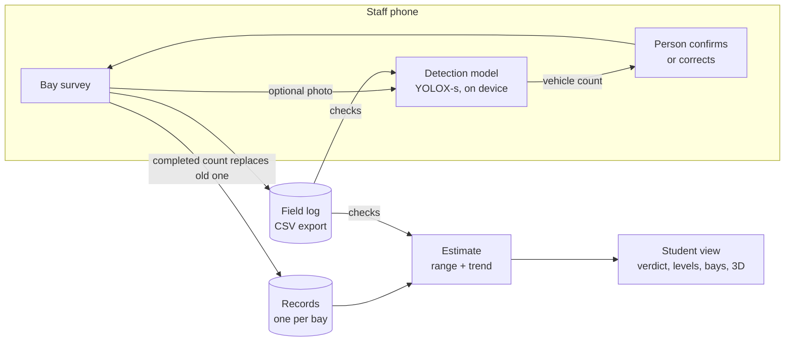

# Architecture

One static web page, no server. Everything runs in the browser and is stored in that browser.

## Layers

| Layer | Files | Rule |
|---|---|---|
| Data | `data/deck.json`, `src/settings.js` | No logic. The only places numbers are tuned |
| Logic | `src/model.js`, `src/detect.js` | Pure functions: no page, no storage, no clock. Time is always passed in, so tests control it |
| Runtime | `src/ai.js`, `src/viewer.js` | Browser-only pieces (model inference, 3D). The page works if either is missing |
| Page | `src/app.js`, `src/index.template.html` | Reads and writes browser storage, calls the logic, renders |
| Build | `scripts/build.cjs` | Inlines data and scripts into `dist/index.html`; copies the model runtime to `dist/ai/` |

## Key rules, and where they live

| Rule | Function |
|---|---|
| A new count replaces the old one; it is never added | `ParkingModel.complete` |
| A count's age runs from when the survey started | `ParkingModel.status` |
| A stale survey cannot overwrite a newer one | version check in `complete` |
| An ageing count becomes a range, then a labelled last count that is never erased | `ParkingModel.estimate`, `ParkingModel.lastCounts` |
| Totals only cover bays that are known, and say how many | `ParkingModel.levelSummary`, `deckSummary` |
| Anything read from storage is validated before display | `ParkingModel.sanitize` |
| One vehicle is counted once, even if seen as car and truck | `CarDetect.nms` |

## What a real deployment would need (not built)

Staff sign-in, a shared server so counts reach other phones, an audit log, conflict handling between observers,
and KSU's approval and real stall numbers.
