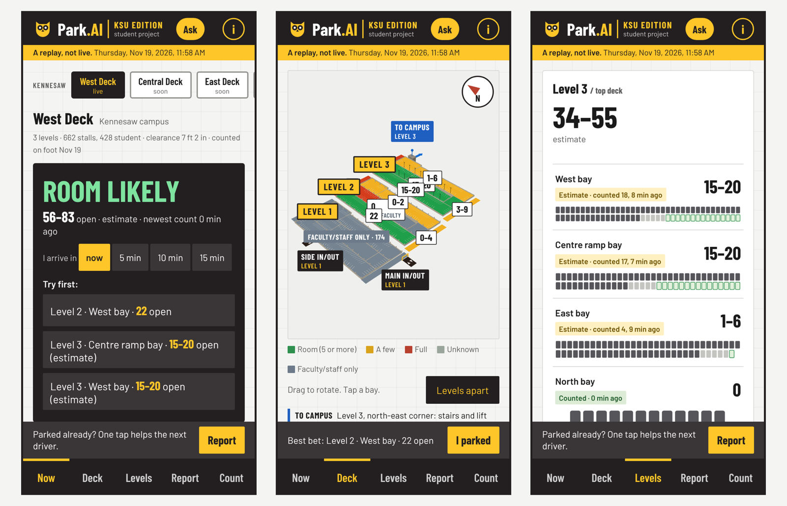

# Hi, I'm Kell 👋

I'm a student at Kennesaw State University. I build things by going out and measuring the problem first: counting, asking people, then writing the software.

  

  Park.AI replaying a real count of West Deck, Thursday Nov 19, 2026, 11:58 AM. 
  <a href="https://boots59.github.io/park.ai/"><strong>Open the live demo →</strong></a>

---

## 🅿️ Park.AI: know where the open spaces are before you drive in

At 11:50 on a Thursday morning, West Deck at KSU had 70 open student spaces. 57 of them were in 3 of the 10 bays, and nothing told a driver which three. So I built the thing that does.

A parking monitor points a phone at a row of cars. A vehicle-detection model **on the phone** counts them. Drivers see which bay to try first, on a 3D model of the deck, with the age of every count on screen.

| Stalls counted on foot | Drivers polled | Late to class because of parking | App testers | Automated tests |
| ---: | ---: | ---: | ---: | ---: |
| **662** | **54** | **49 of 54** | **9** | **82** |

One deck, one day, one counter. A student prototype, not a KSU system. Every number is in <a href="https://github.com/boots59/park.ai/blob/main/docs/RESULTS.md">docs/RESULTS.md</a> with its raw data.

[**Try it →**](https://boots59.github.io/park.ai/) · [**Code →**](https://github.com/boots59/park.ai) · [**The survey analysis →**](https://github.com/boots59/park.ai/blob/main/docs/SURVEY-ANALYSIS.md) · [**What is and is not proven →**](https://github.com/boots59/park.ai/blob/main/docs/EVIDENCE.md)

<strong>How it works</strong>

 

| Part | What it does |
| --- | --- |
| **Camera count** | YOLOX on ONNX Runtime Web, running in the browser. Frames are measured on the device and dropped: no plates, no faces, nothing uploaded |
| **Estimates between counts** | A statistical model turns an ageing count into a range, follows the trend, and ranks where to try first |
| **3D deck** | three.js model of the deck with the entrances, the exit to campus, faculty parking and a compass |
| **Student reports** | One anonymous tap after parking ("plenty", "a few", "full"), kept as lower trust than a staff count |
| **No server** | A static site; shared counts go through a small Firebase database with write-once rules |

<strong>What I did myself, and what AI did</strong>

 

I framed the problem, made the product decisions, counted all 662 stalls, walked the deck twice, polled 54 drivers, ran the app tests with students and met KSU parking operations. AI coding assistants wrote the code under my direction; the 3D model was built by a friend. The full record is in [CONTRIBUTIONS.md](https://github.com/boots59/park.ai/blob/main/docs/CONTRIBUTIONS.md).

Built for the **KSU AI Club Hackathon 2026**.

---

## 📫 Reach me

- LinkedIn: `[your LinkedIn URL]`
- Email: `[an address you are happy to make public]`
